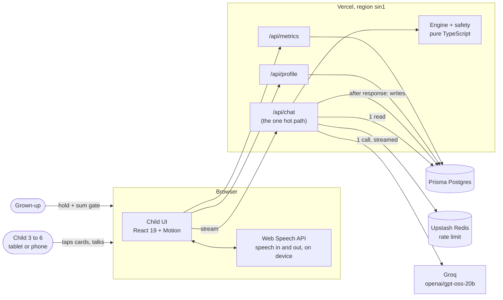
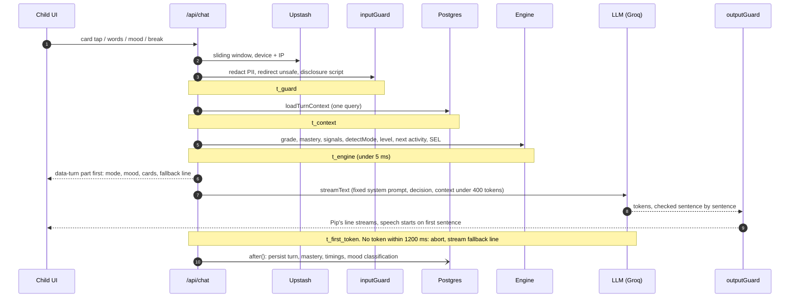
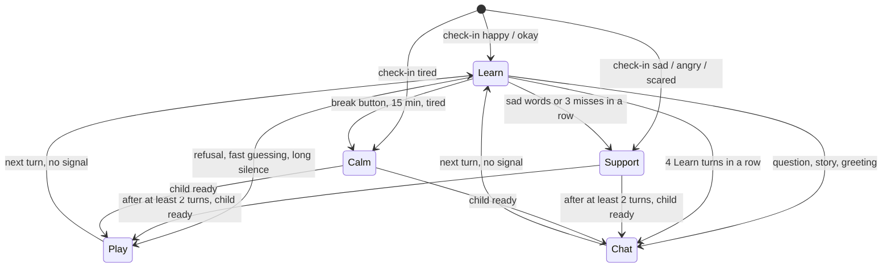
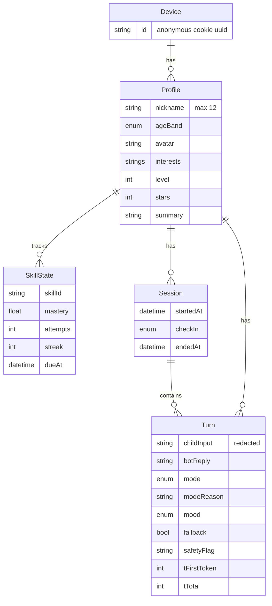

# Architecture

Pip is one Next.js 16 app on Vercel. A deterministic TypeScript engine decides what to teach and how Pip should behave; the LLM only turns that decision into one short, warm spoken line.

## 1. System context

Audio never leaves the device: the browser transcribes speech and speaks Pip's lines. Only text reaches the server.

## 2. One child turn (`POST /api/chat`)

The picture cards and the scripted line are on screen before the LLM answers, so even a slow or failed LLM call never leaves the child waiting.

## 3. Mode state machine

Rules run in priority order (feelings first, teaching last). Support and Calm hold for at least two turns, and leaving Support never goes straight back to teaching.

## 4. Data model

Every child relation cascades, so "Delete all data" in the grown-up corner removes every row for that profile.
